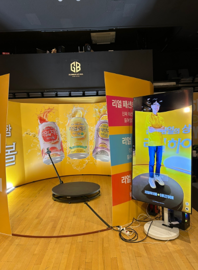
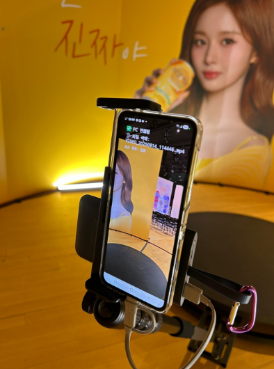
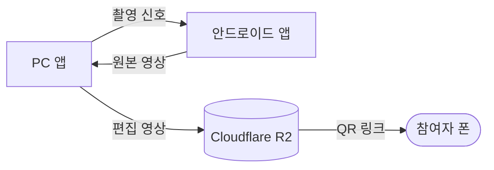
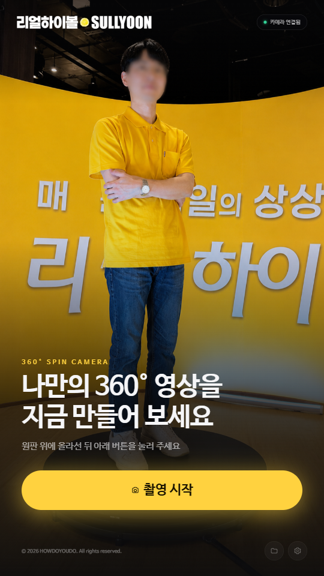
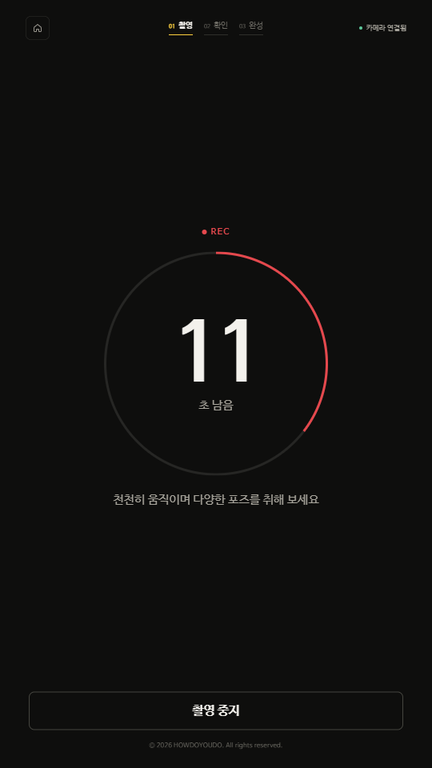
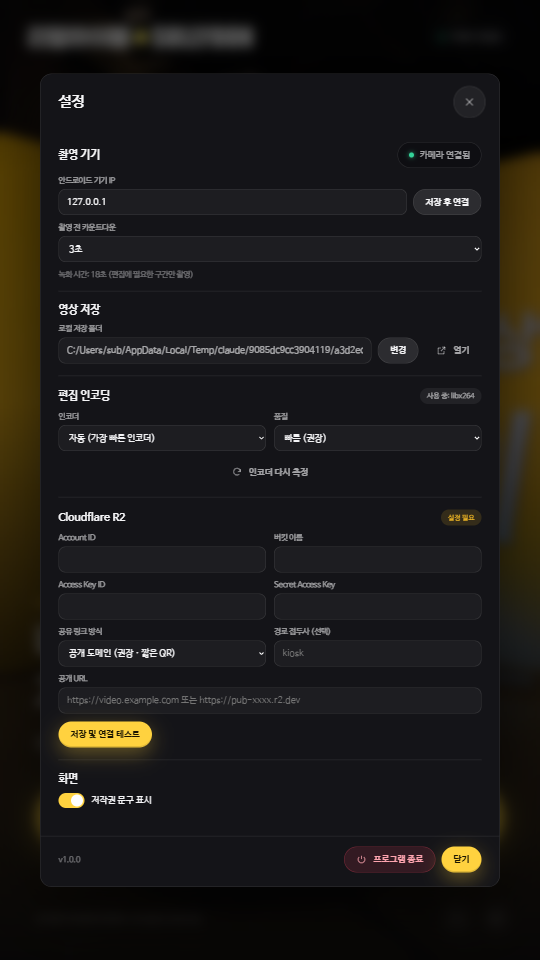

# 360도 촬영 키오스크 v2

이벤트 부스용 360도 회전 촬영 시스템입니다.
회전 암에 단 스마트폰으로 참여자를 촬영하고, 편집한 영상을 QR 코드로 전달합니다.

<div align="center">
  
  
</div>

## 구성

| 구성 요소 | 역할 |
| --- | --- |
| **안드로이드 앱** (`mobile_app/`) | 회전 암의 폰에서 녹화. 제어 신호를 받는 WebSocket 서버(:8080)와 영상 파일 서버(:8081) |
| **PC 앱** (`electron/`) | 키오스크 화면, 촬영 제어, 영상 편집(FFmpeg), 업로드, QR 표시 |
| **Cloudflare R2** | 편집 영상 저장소. QR이 이 주소를 가리킵니다 |

폰과 PC는 같은 네트워크에 있어야 합니다.



## 흐름

1. 진행자가 **촬영 시작** → 카운트다운
2. 폰이 18초 녹화 후 PC로 원본 전송
3. PC가 바로 편집을 시작하고, 그동안 원본 미리보기를 보여 줌 → **완성** 또는 **다시 찍기**
4. 편집 영상을 R2에 업로드 → 화면에 QR 표시
5. 참여자가 QR로 영상 열람·저장. 120초 뒤 자동으로 처음 화면으로

영상은 PC의 저장 폴더에도 날짜별로 남습니다.

## 화면

<table>
  <tr>
    <td align="center"><br/><b>홈</b></td>
    <td align="center"><br/><b>촬영 중</b></td>
    <td align="center"><br/><b>관리자 설정</b></td>
  </tr>
</table>

## 실행

```bash
cd electron
npm install
npm start           # 개발 모드
npm run make        # 설치 파일 빌드
```

안드로이드 앱은 `mobile_app/`을 Android Studio로 열어 빌드합니다.

처음 실행하면 홈 화면 우측 하단 **설정**에서 폰 IP와 R2 정보를 입력하고, **네트워크 테스트**로 환경을 확인하세요.
설정 파일(`KEY=VALUE`)로 한 번에 불러올 수도 있습니다.


## 라이선스

MIT License. 작성자: 김승섭 (sub9707)
